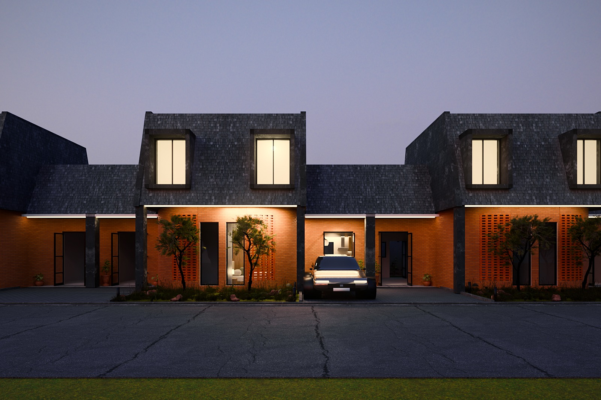
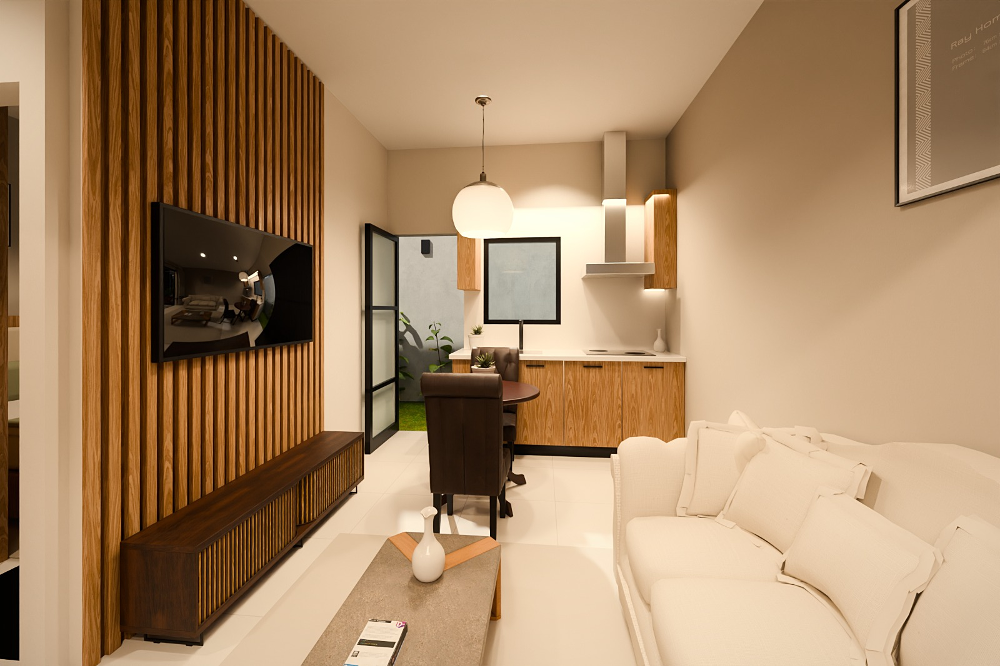

# 3D-model

A 3D model of a type 36/72 house, built in Blender with Python scripts instead of by hand. A side project outside my usual web work.




## How it is built

The scene is generated in three stages:

1. `scripts/build_house.py` — walls, floors, roof and cameras from the floor plan
2. `scripts/stage2_materials.py` — materials and lighting
3. `scripts/stage3_furnish.py` — furniture and plants

`scripts/build_all.sh` runs all three. `scripts/grade.py` colour grades the final renders.

## Folders

- `final/` — final renders
- `graded/` — the same renders after colour grading
- `preview/` — test renders made along the way
- `assets/` — HDRIs and models from [Poly Haven](https://polyhaven.com)
- `rumah_36_72.blend` — the finished scene

## Requirements

Blender, run from the command line:

```bash
blender -b -P scripts/build_house.py
```
